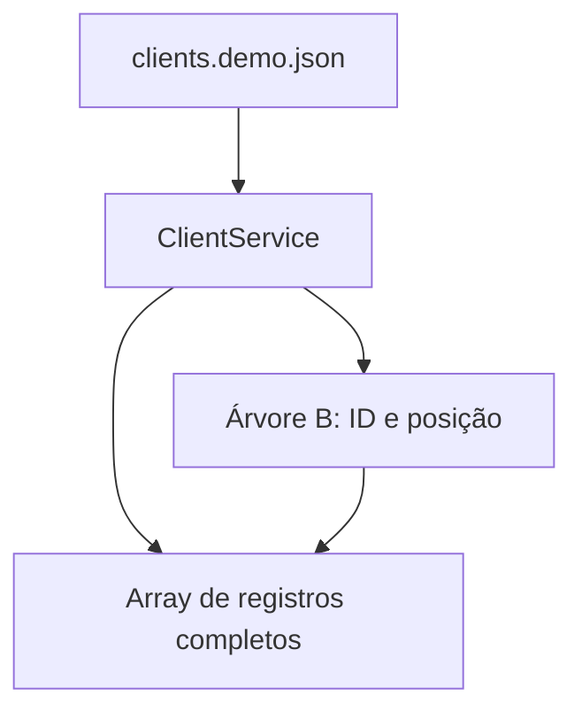

# Base demonstrativa de clientes

A base `globalsim/data/clients.demo.json` fornece 1.000 clientes para demonstrar o armazenamento de registros em memória, a indexação pela Árvore B, as buscas e a listagem ordenada na Etapa 2.

## Como a base é gerada

Cada registro tem os campos `id`, `nome`, `email`, `esim`, `pacote` e `status`. Os IDs são inteiros sequenciais de 1 a 1.000 e os e-mails usam o domínio `example.test`. Os status são `ativo` ou `inativo`. A base inclui 200 clientes com eSIM e pacote nulos. Para os demais, o gerador alterna os códigos retornados por `PackageService.list_all()`.

O gerador reutiliza `validate_client()` e verifica IDs repetidos antes da gravação. Com a quantidade padrão, a semente `2026` e o mesmo catálogo, `random.Random(seed)` reproduz a ordem de inserção fora da sequência dos IDs.

Isso permite observar divisões durante a construção da Árvore B e demonstrar que os registros não precisam estar fisicamente ordenados por ID para serem recuperados em ordem crescente.

## Organização dos registros em memória

Durante a inicialização, o `ClientService` carrega os registros do JSON para um array, preservando a ordem original dos dados.

A Árvore B funciona como índice desse array, utilizando o ID de cada cliente como chave e armazenando a posição correspondente.

A organização pode ser representada por:



Por exemplo, considere três registros carregados na seguinte ordem:

| Posição no array | ID |
|---:|---:|
| 0 | 30 |
| 1 | 10 |
| 2 | 20 |

A Árvore B estabelece as seguintes associações:

| Chave | Posição |
|---:|---:|
| 10 | 1 |
| 20 | 2 |
| 30 | 0 |

Uma busca pelo ID 20 retorna a posição 2, permitindo recuperar diretamente o registro no array.

O percurso em ordem da árvore retorna as posições `[1, 2, 0]`, possibilitando listar os registros pelos IDs `[10, 20, 30]` sem reorganizar o array.

A base demonstrativa de 1.000 clientes utiliza o mesmo mecanismo.

## Geração e proteção dos dados

Execute na raiz do repositório. O exemplo grava em um diretório temporário e imprime as métricas da carga.

```bash
demo_dir="$(mktemp -d)"
python -m scripts.generate_clients_demo --output "$demo_dir/clients.demo.json"
```

O caminho padrão é `globalsim/data/clients.demo.json`. `--count` aceita um inteiro positivo e `--seed` aceita um inteiro. Para atualizar explicitamente a base demonstrativa versionada, execute `python -m scripts.generate_clients_demo --replace`.

O gerador escreve o lote em um arquivo temporário e confirma a carga pelo `ClientService` antes de publicar o arquivo completo.

A operação padrão recusa um destino ocupado, inclusive se outro processo o criar durante a geração.

A opção `--replace` autoriza apenas destinos chamados `clients.demo.json`. Essa regra e a rejeição de links simbólicos protegem `clients.json`, `countries.json`, `packages.json` e as outras bases.

## Carga e instrumentação

Use a interface pública do serviço para observar a carga e registrar a diferença no contador de buscas.

```python
from globalsim.services.clients import ClientService

service = ClientService("globalsim/data/clients.demo.json")

print(service.statistics())

assert len(service.clients) == 1000
assert service.find(1) is not None
assert service.find(1001) is None

print(service.statistics())
```

Os resultados de referência documentados para a base demonstrativa são:

| Métrica | Após a carga | Após as duas buscas |
|---|---:|---:|
| `size` | 1.000 | 1.000 |
| `height` | 5 | 5 |
| `node_count` | 315 | 315 |
| `splits` | 310 | 310 |
| `lookups` | 0 | 2 |

A correção da indexação preserva os algoritmos de inserção e divisão, de modo que essas métricas são esperadas para a mesma sequência de chaves e o mesmo grau mínimo.

### Verificação da indexação

Para observar a relação entre a Árvore B e o array, execute:

```python
from globalsim.services.clients import ClientService

service = ClientService("globalsim/data/clients.demo.json")

client_id = 500

position = service.tree.find(client_id)

assert position is not None

record = service.clients[position]

assert record["id"] == client_id

print("ID:", client_id)
print("Posição no array:", position)
print("Registro:", record)
```

O método `find()` da árvore retorna a posição do cliente. O registro completo é recuperado diretamente pelo índice do array.

A listagem ordenada pode ser verificada por:

```python
assert [
    client["id"]
    for client in service.list_all()
] == list(range(1, 1001))
```

Esses exemplos são destinados à observação da implementação. As rotas Flask utilizam a interface pública do `ClientService`.

## Uso no Flask

Com as dependências instaladas, execute o trecho abaixo a partir da raiz. `CLIENTS_PATH` aponta para uma cópia temporária, permitindo cadastrar ou editar clientes durante a demonstração. Abra a tela em `http://127.0.0.1:5000/clients`.

```python
from pathlib import Path
from shutil import copyfile
from tempfile import TemporaryDirectory

from globalsim.app import create_app

with TemporaryDirectory() as directory:
    demo_path = Path(directory) / "clients.demo.json"

    copyfile(
        "globalsim/data/clients.demo.json",
        demo_path
    )

    app = create_app({
        "CLIENTS_PATH": demo_path
    })

    app.run()
```

Os novos clientes são acrescentados ao final do array e indexados pela Árvore B.

As atualizações preservam as posições existentes, e os registros completos são persistidos no JSON temporário.

Ao reiniciar o serviço utilizando o mesmo arquivo, o array e o índice são reconstruídos.

## Testes

```bash
python -m unittest discover -s tests -v
python -m unittest discover -s tests -q
```

Durante o desenvolvimento original da base demonstrativa, as duas execuções passaram com 221 testes em Python 3.12, incluindo 15 da base demonstrativa.

Após a correção da Árvore B como índice de posições, em 27/11/2026, a suíte completa passou com 240 testes em Python 3.10.12, incluindo os 15 testes da base demonstrativa.

Os testes verificam:

- Geração determinística e reprodução byte a byte.
- Pacotes associados ao catálogo.
- Validação dos registros.
- Proteção contra sobrescrita de arquivos.
- Carregamento de 1.000 clientes.
- Busca por ID utilizando a Árvore B.
- Correspondência entre os IDs e as posições dos registros.
- Listagem ordenada sem reorganização do array.
- Configuração do Flask com caminhos alternativos.

O gerador e o arquivo demonstrativo original permaneceram inalterados durante a correção.