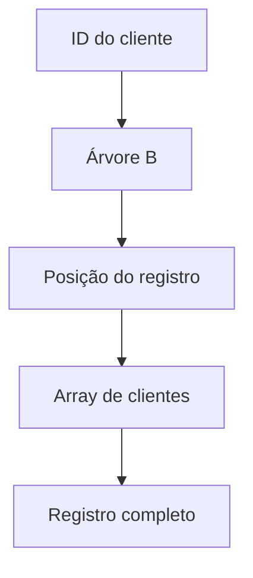

# Gerenciamento Web de Clientes — GlobalSIM

## 1. Objetivo

A feature `feature/client-web` disponibiliza uma interface web para gerenciamento de clientes, utilizando a Árvore B como índice para busca por identificadores e um array em memória para armazenamento dos registros completos.

A implementação integra os serviços de clientes, países e pacotes à aplicação Flask, preservando as funcionalidades existentes da Etapa 1.

## 2. Funcionalidades implementadas

- Listagem de clientes em ordem crescente de ID.
- Busca de clientes por ID.
- Visualização dos detalhes de um cliente.
- Cadastro de novos clientes.
- Edição de clientes existentes.
- Associação de eSIM e pacote de dados.
- Persistência dos registros em JSON.
- Consulta integrada de cobertura entre clientes e países.
- Instrumentação da Árvore B.

## 3. Estruturas de dados

### Árvore B

A Árvore B funciona como índice dos clientes, utilizando o ID como chave única e associando cada chave à posição do registro no array de clientes.

Cada nó armazena:

- Chaves ordenadas (`keys`).
- Posições correspondentes (`positions`).
- Referências para os nós filhos (`children`).
- Indicador de nó folha (`leaf`).

Os registros completos não são armazenados nos nós da árvore.

Durante as divisões, as posições são movimentadas junto com suas respectivas chaves, preservando as associações.

### Array de clientes

O `ClientService` mantém os registros completos em uma lista Python, utilizada como array dinâmico.

Durante a inicialização, os clientes são carregados do JSON na ordem em que estão armazenados no arquivo. Cada ID é associado à posição correspondente na Árvore B.

As operações são realizadas da seguinte forma:

- Cadastro: o novo registro é acrescentado ao final do array e seu ID é indexado na árvore.
- Busca: a árvore retorna a posição do cliente, permitindo acessar diretamente o registro.
- Listagem: o percurso em ordem da árvore retorna as posições em ordem crescente de ID.
- Atualização: o registro é substituído na mesma posição, sem alterar o ID ou reorganizar a árvore.

O array não é reorganizado durante essas operações, preservando a validade das posições armazenadas na árvore.

### Integração entre árvore e array



O `ClientService` coordena as operações e mantém a consistência entre as estruturas.

As rotas Flask utilizam a interface pública do serviço, sem precisar conhecer os detalhes internos da indexação.

### Tabela Hash

A Tabela Hash é utilizada para consultar países por seus respectivos códigos.

A consulta integrada utiliza a Árvore B para localizar a posição do cliente no array e a Tabela Hash para localizar o país.

### Catálogo de pacotes

O `PackageService` disponibiliza os pacotes registrados no catálogo e permite verificar se determinado país está incluído no pacote associado ao cliente.

## 4. Rotas disponibilizadas

| Método | Rota | Funcionalidade |
|---|---|---|
| GET | `/clients` | Listagem de clientes |
| GET | `/clients/search?id=58372` | Busca por ID |
| GET | `/clients/58372` | Detalhes do cliente |
| GET | `/clients/new` | Formulário de cadastro |
| POST | `/clients/new` | Cadastro de cliente |
| GET | `/clients/58372/edit` | Formulário de edição |
| POST | `/clients/58372/edit` | Atualização do cliente |
| GET | `/clients/coverage` | Consulta integrada de cobertura |
| GET | `/clients/instrumentation` | Estatísticas da Árvore B |

## 5. Validação dos registros

O cadastro e a edição realizam as seguintes validações:

- ID inteiro positivo e único.
- Nome obrigatório.
- E-mail válido.
- Status obrigatório.
- eSIM opcional.
- Pacote opcional, com código existente no catálogo quando informado.
- Impossibilidade de alterar o ID de um cliente existente.

Em caso de sucesso no cadastro ou na edição, a aplicação redireciona o usuário para a página de detalhes.

A restrição de alteração do ID também preserva a consistência do índice, pois cada chave deve continuar associada ao registro correspondente.

## 6. Consulta integrada de cobertura

A consulta integrada permite informar o ID de um cliente e o código de um país.

Exemplo:

`/clients/coverage?client_id=58372&codigo=IT`

A aplicação apresenta os dados do cliente, as informações de cobertura do país e, quando disponível, os dados do pacote contratado.

A compatibilidade geográfica do pacote é verificada por meio da lista de países incluídos no catálogo.

A existência de cobertura cadastrada não implica necessariamente que o país esteja incluído no pacote do cliente. A compatibilidade geográfica também não representa uma autorização de uso baseada no status do cliente.

As consultas utilizam diretamente as estruturas de dados em memória, sem recarregar os arquivos JSON.

A recuperação do cliente utiliza a posição encontrada pela Árvore B para acessar seu registro no array, sem realizar uma busca linear entre os clientes.

## 7. Instrumentação da Árvore B

A rota `/clients/instrumentation` apresenta as seguintes métricas:

| Métrica | Descrição |
|---|---|
| `size` | Quantidade de clientes cadastrados |
| `height` | Altura da árvore |
| `node_count` | Quantidade de nós |
| `splits` | Quantidade de divisões de nós |
| `lookups` | Quantidade de buscas realizadas |

As métricas são obtidas diretamente da Árvore B em memória.

O contador de buscas inclui consultas bem-sucedidas, consultas sem resultado e chamadas ao método `find()` realizadas durante atualizações.

Consultar a página de instrumentação não incrementa o contador de buscas.

Os contadores não são persistidos no JSON. Ao reiniciar a aplicação, a árvore é reconstruída a partir das posições dos registros carregados no array, e as divisões decorrentes desse carregamento são contabilizadas.

## 8. Persistência

Os caminhos padrão dos arquivos de dados são:

- `globalsim/data/clients.json`
- `globalsim/data/countries.json`
- `globalsim/data/packages.json`

A aplicação permite configurar caminhos alternativos por meio de:

- `CLIENTS_PATH`
- `COUNTRIES_PATH`
- `PACKAGES_PATH`

O arquivo JSON de clientes armazena os registros completos, preservando a ordem do array.

A Árvore B não é persistida diretamente no arquivo. Sua estrutura é reconstruída durante a inicialização do serviço.

Após um cadastro ou atualização bem-sucedida, o array é gravado em JSON utilizando arquivo temporário e substituição atômica.

Caso uma operação falhe, o serviço restaura o estado anterior da árvore, do array e das métricas.

As operações de leitura não realizam alterações nos arquivos de dados.

Os testes automatizados utilizam arquivos temporários para preservar os dados originais do projeto.

## 9. Execução da aplicação

A partir da raiz do repositório, com o ambiente virtual ativo e as dependências instaladas, execute:

```bash
python -m flask --app globalsim.app run
```

Acesse:

`http://127.0.0.1:5000`

## 10. Testes automatizados

Para executar somente os testes das rotas de clientes:

```bash
python -m unittest discover -s tests -p "test_client_routes.py" -v
```

Para executar os testes da Árvore B:

```bash
python -m unittest discover -s tests -p "test_b_tree.py" -v
```

Para executar os testes do serviço de clientes:

```bash
python -m unittest discover -s tests -p "test_client_service.py" -v
```

Para executar todos os testes do projeto:

```bash
python -m unittest discover -s tests -v
```

Para executar a versão resumida:

```bash
python -m unittest discover -s tests -q
```

### Resultados obtidos durante o desenvolvimento

| Indicador | Quantidade |
|---|---:|
| Testes existentes antes da feature | 108 |
| Novos testes adicionados | 61 |
| Testes das rotas de clientes | 61 |
| Total de testes aprovados na conclusão da feature | 169 |
| Falhas | 0 |

Após a correção da Árvore B como índice de posições, em 27/11/2026, a suíte completa apresentou os seguintes resultados:

| Indicador | Quantidade |
|---|---:|
| Testes da Árvore B | 31 |
| Testes do ClientService | 36 |
| Testes das rotas de clientes | 61 |
| Total de testes aprovados no projeto | 240 |
| Falhas | 0 |
| Erros | 0 |

Os testes abrangem cadastro, edição, busca, listagem, persistência, validação de entradas, associação de pacotes, cobertura integrada e instrumentação da Árvore B.

Também verificam a preservação dos arquivos JSON, o uso direto das estruturas de dados e o tratamento de falhas de persistência.

Os testes específicos da indexação verificam:

- Correspondência entre IDs e posições.
- Preservação das associações durante divisões de nós.
- Recuperação de clientes na posição zero.
- Preservação das posições durante cadastros e atualizações.
- Listagem ordenada sem reorganização do array.
- Reconstrução do índice após reinicialização.
- Rollback da árvore e do array.
- Carregamento e consulta de 1.000 clientes.

As rotas Flask permaneceram compatíveis com a nova implementação do serviço de clientes.

## 11. Arquivos da implementação

- `globalsim/app.py`
- `globalsim/routes/clients.py`
- `globalsim/structures/b_tree.py`
- `globalsim/services/clients.py`
- `globalsim/templates/base.html`
- `globalsim/templates/clients.html`
- `globalsim/templates/client_form.html`
- `globalsim/templates/client_detail.html`
- `globalsim/templates/client_coverage.html`
- `globalsim/templates/client_instrumentation.html`
- `tests/test_b_tree.py`
- `tests/test_client_service.py`
- `tests/test_client_routes.py`
- `docs/client_web.md`

## 12. Histórico de implementação

A implementação foi organizada em commits incrementais:

1. `9da91d8` — feat: register client services in Flask
2. `3bd2773` — feat: add client listing and lookup routes
3. `dae2639` — feat: add client forms and update routes
4. `bab6bbc` — feat: integrate client and country coverage
5. `90af505` — feat: add B-tree instrumentation page

Em 27/11/2026, após a entrega da Etapa 2, a implementação da Árvore B foi corrigida na branch `fix/b-tree-indexing` para separar a indexação do armazenamento dos registros.

A interface pública do `ClientService` foi preservada, mantendo a compatibilidade com as rotas e os demais módulos da aplicação.

## 13. Escopo

Esta feature é responsável pela interface web de gerenciamento de clientes e pela integração com as estruturas de dados e serviços existentes.

Funcionalidades relacionadas a grafos, algoritmos de caminhos e planejamento de viagens não fazem parte desta implementação.