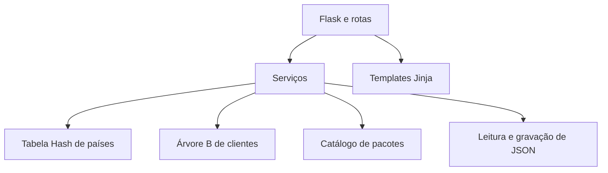

# GlobalSIM — Entrega da Etapa 2

| Identificação | Informação |
|---|---|
| Disciplina | Estruturas de Dados II |
| Curso e instituição | Sistemas de Informação, Universidade do Estado da Bahia (UNEB) |
| Equipe | Anderson de Jesus Soledade Filho, João Cleber Freire Ramos Pinto e Sofia Macêdo Costa |
| Etapa e prazo | Etapa 2 — Árvore B e gerenciamento de clientes, 24/11/2026 |

A Etapa 2 amplia o GlobalSIM para gerenciar clientes, eSIMs e pacotes com uma Árvore B. O cadastro de países e as consultas de cobertura da Etapa 1 continuam disponíveis na Tabela Hash. A consulta cliente × destino e o Planejador Multidestinos integram as duas estruturas.

A referência do checklist é o enunciado `TrabalhoPratico-2026.2.pdf`. As páginas 4–6 especificam a Etapa 2. As páginas 2 e 9 definem as regras gerais e a persistência. A página 10 lista os critérios de avaliação e as responsabilidades na apresentação.

## Execução e testes

Use Python 3.10 ou superior. Na raiz do repositório, instale as dependências e inicie a aplicação.

```bash
python3 -m venv .venv
source .venv/bin/activate
python -m pip install -r requirements.txt
python -m flask --app globalsim.app:create_app run
```

Acesse [http://127.0.0.1:5000](http://127.0.0.1:5000). Para preparar uma apresentação com dados isolados, siga o [roteiro](#roteiro-de-demonstração).

Execute a suíte na raiz, com o ambiente virtual ativo.

```bash
python -m unittest discover -s tests -v
python -m unittest discover -s tests -q
```

Na revisão `bfd684e` da `dev`, a suíte passou com **210 testes** nas duas execuções, com Python 3.12.14 e Flask 3.1.2. A aplicação também foi iniciada via CLI e verificada por HTTP com arquivos temporários. O roteiro de países, clientes, persistência após reinício, cobertura integrada e os cinco cenários do Planejador passaram nessa execução.

## Arquitetura e estruturas

[`create_app()`](../globalsim/app.py) inicializa os serviços com os arquivos de dados e registra os Blueprints de países, clientes e planejamento. As [rotas](../globalsim/routes/) processam parâmetros e formulários, chamam os serviços e renderizam [templates Jinja](../globalsim/templates/). Os [modelos](../globalsim/models/) validam e normalizam os registros. Os [serviços](../globalsim/services/) coordenam as operações sobre as [estruturas em memória](../globalsim/structures/) e os módulos de [persistência](../globalsim/persistence/). Os [testes](../tests/) exercitam estruturas, serviços, persistência e fluxos Flask com arquivos temporários.



### Tabela Hash

[`HashTable`](../globalsim/structures/hash_table.py) encapsula um `dict` do Python que guarda cada país pelo código de duas letras, como `IT`. O [serviço de países](../globalsim/services/countries.py) normaliza o código, e a busca usa `dict.get()` sobre os dados carregados. A estrutura permite inserir, consultar, atualizar, remover e listar registros. O código permanece imutável na edição. A página `/instrumentation` mostra chaves, tamanho, registros carregados, buscas, acertos, buscas sem resultado e contadores de inserção, alteração e remoção. O `dict` trata colisões internamente. A aplicação mede operações da Hash.

### Árvore B

[`BTree`](../globalsim/structures/b_tree.py) é uma árvore balanceada com várias chaves por nó e folhas no mesmo nível. Esse agrupamento reduz a quantidade de níveis que uma busca precisa percorrer. Cada chave é o ID inteiro, positivo, único e imutável do cliente. O grau mínimo `t` padrão é 3, o que permite até `2t − 1` chaves por nó, ou cinco. Um nó que fica abaixo da raiz tem pelo menos `t − 1` chaves.

- **Busca.** Compara o ID com as chaves do nó em ordem. Se encontrar uma igualdade, devolve uma cópia do registro. Caso contrário, desce pelo filho correspondente ao intervalo, ou retorna ausência ao chegar a uma folha.
- **Inserção.** Verifica se o ID já existe, divide a raiz cheia se necessário e, durante a descida, divide um filho cheio antes de entrar nele. A chave mediana e seu registro sobem para o pai, e as chaves restantes são repartidas em dois nós. Uma divisão da raiz acrescenta um nível.
- **Listagem e alteração.** O percurso em ordem visita cada filho intercalado com as chaves do nó e devolve os clientes em ordem crescente de ID. Na edição, o [serviço de clientes](../globalsim/services/clients.py) valida os campos e substitui o registro associado à mesma chave.
- **Métricas.** `/clients/instrumentation` mostra clientes, altura em níveis, quantidade de nós, divisões e buscas. As divisões feitas na carga também contam. O total de buscas inclui acertos, buscas sem resultado e chamadas a `find()` nas atualizações. A busca Web por um ID existente redireciona à tela de detalhes, que consulta o mesmo ID novamente.

### Persistência e catálogo

Na inicialização, `CountryService` e `ClientService` leem e validam os JSONs e inserem os registros nas estruturas. Um arquivo de clientes ausente inicia a árvore vazia, e um JSON inválido interrompe a carga. O [catálogo](../globalsim/services/packages.py) valida os pacotes uma vez e os mantém em um dicionário por código. As consultas posteriores usam os serviços e os dados em memória.

Depois de uma mutação, os serviços de países e clientes gravam os registros completos em um arquivo temporário e substituem o destino atomicamente com `os.replace()`. Se a operação falhar, restauram a cópia anterior da estrutura e das métricas. O JSON guarda os registros. Na próxima inicialização, a árvore é reconstruída e os contadores são recalculados para a nova instância.

O enunciado permite armazenar os pacotes em JSON ou lista. O [catálogo simulado](../globalsim/data/packages.json) contém os cinco pacotes da tabela.

| Código | Pacote | Franquia | Validade | Países |
|---|---|---:|---:|---|
| 101 | Europa Basic | 5 GB | 15 dias | PT, ES, FR, IT |
| 102 | Europa Plus | 10 GB | 30 dias | PT, ES, FR, IT |
| 201 | América Basic | 5 GB | 15 dias | BR, US, CA |
| 202 | América Plus | 15 GB | 30 dias | BR, US, CA |
| 301 | Global | 20 GB | 30 dias | BR, PT, ES, FR, IT, US, CA, JP |

### Consulta cliente × país

Em [`/clients/coverage`](../globalsim/routes/clients.py), o ID localiza o cliente na Árvore B, e o código localiza o país na Tabela Hash. O serviço de pacotes consulta o código associado ao cliente. A tela mostra os dados das duas consultas e compara o destino com a lista de países do pacote. A cobertura cadastrada depende da Hash. A compatibilidade é geográfica e independe do status do cliente.

### Planejador Multidestinos

O [Planejador Multidestinos com Recomendação Automática de Pacotes eSIM](differential.md) recebe a origem, os destinos em ordem, a duração, o consumo estimado e um ID de cliente opcional. A origem é validada pelo formato. A Hash verifica a cobertura dos destinos, com códigos repetidos reduzidos à primeira ocorrência. O [serviço](../globalsim/services/trip_planner.py) seleciona pacotes que abrangem todos os destinos e atendem à franquia e à validade. Entre os elegíveis, prioriza a menor franquia suficiente, a menor validade excedente e, por último, o menor código.

A tela exibe a cobertura de cada destino, o pacote recomendado, quando houver, e a justificativa da seleção ou da ausência de opção. A Árvore B localiza o cliente informado para mostrar o eSIM e o pacote atual. A recomendação é consultiva e usa um único pacote simulado. A verificação de conectividade e de rotas por trecho fica para a Etapa 3.

## Checklist de requisitos e critérios de avaliação

| Enunciado | Implementação | Como verificar | Situação |
|---|---|---|---|
| Preservar a Etapa 1 e a Hash (p. 1, 3–6, 10) | [Hash](../globalsim/structures/hash_table.py), [rotas de países](../globalsim/routes/countries.py), [JSON de países](../globalsim/persistence/countries_json.py) | Demonstração 1 e [testes de rotas](../tests/test_routes.py). | Concluído e verificado |
| Árvore B funcional com ID único como chave, busca efetiva e divisões (p. 2, 4–6, 10) | [Árvore B](../globalsim/structures/b_tree.py), [modelo](../globalsim/models/client.py), [serviço](../globalsim/services/clients.py) | [Testes da Árvore B](../tests/test_b_tree.py), inclusive duplicatas, inserções e divisões. | Concluído e verificado |
| Carregar dados na Árvore B e trabalhar com centenas de clientes, recomendados cerca de 1.000 gerados automaticamente (p. 4–6, 9) | [ClientService](../globalsim/services/clients.py), [persistência](../globalsim/persistence/clients_json.py), [PR da base](https://github.com/macedosofia/ed2_2026.2/pull/19) | A carga de JSON já faz parte da suíte. Para o volume recomendado, confira a base na revisão integrada e siga a demonstração 3. | Carga implementada e verificada. Base demonstrativa aguardando integração. |
| Cadastro, busca, listagem e alteração (p. 5–6) | [Rotas de clientes](../globalsim/routes/clients.py), [serviço](../globalsim/services/clients.py) | Demonstração 2 e [testes das rotas](../tests/test_client_routes.py). | Concluído e verificado |
| Associação de eSIM e pacote ao cliente (p. 5) | [Formulário](../globalsim/templates/client_form.html), [validação Web](../globalsim/routes/clients.py), [catálogo](../globalsim/data/packages.json) | Edite um cliente e selecione o pacote. Confira o eSIM e o pacote nos detalhes e na consulta integrada. | Concluído e verificado |
| Persistência e consultas pelas estruturas em memória (p. 2, 5, 9) | [Persistência](../globalsim/persistence/), [serviços de países e clientes](../globalsim/services/) | Reinicie com os mesmos arquivos. Os [testes de clientes](../tests/test_client_service.py) e [de países](../tests/test_country_service.py) exercitam carga, consultas e falhas. | Concluído e verificado |
| Integração cliente × país e consulta ao catálogo (p. 5–6, 10) | [Rota integrada](../globalsim/routes/clients.py), [serviço de pacotes](../globalsim/services/packages.py) | Demonstração 4 e [testes das rotas](../tests/test_client_routes.py). | Concluído e verificado |
| Primeira versão funcional do diferencial aprovado (p. 2, 6, 10) | [Serviço](../globalsim/services/trip_planner.py), [Blueprint](../globalsim/routes/trip_planner.py), [fábrica Flask](../globalsim/app.py) | Demonstração 5 e [testes de integração](../tests/test_stage2_integration.py). | Concluído e verificado |
| Python/Flask, formulários HTML e Jinja, mutações por POST e estruturas separadas das rotas (p. 2, 10) | [Aplicação](../globalsim/app.py), [rotas](../globalsim/routes/), [templates](../globalsim/templates/), [estruturas](../globalsim/structures/) | Use os formulários e confira os redirecionamentos 303 após salvar com sucesso. | Concluído e verificado |
| Instrumentação da Hash e da Árvore B (p. 4, 10) | [Tela da Hash](../globalsim/templates/instrumentation.html), [tela da Árvore B](../globalsim/templates/client_instrumentation.html) | Compare métricas antes e depois das operações nas demonstrações 1 e 3. | Concluído e verificado |
| Repositório e README com equipe, execução, estruturas e diferencial (p. 10) | [README](../README.md), este guia | Confira a identificação e execute os comandos da raiz do repositório. | Preparado para revisão |
| Demonstração funcional e domínio de todos os integrantes (p. 10) | [Roteiro](#roteiro-de-demonstração) e [perguntas](#preparação-para-a-apresentação) | Cada integrante explica as estruturas, a ligação com Flask e a decisão do recomendador. | Roteiro pronto. Ensaio da equipe pendente. |
| Grafo ponderado, BFS, DFS, Dijkstra, visualização e integração com a rede (p. 6–8, 10) | Escopo da entrega de 01/12/2026 | Demonstrar conectividade e rota de menor latência na entrega final. | Reservado para a Etapa 3 |

## Roteiro de demonstração

### Preparação

Em Bash, crie um diretório temporário e copie os países de demonstração. A aplicação usa um arquivo separado para clientes. Depois da integração da base de 1.000, use também o segundo `cp` em um diretório temporário novo para iniciar a demonstração com o conjunto populado.

```bash
demo_dir="$(mktemp -d)"
cp globalsim/data/countries.demo.json "$demo_dir/countries.json"
# Execute a linha seguinte após o merge da base demonstrativa.
# cp globalsim/data/clients.demo.json "$demo_dir/clients.json"
```

Inicie a aplicação com a configuração abaixo. Para demonstrar o reinício, pare com `Ctrl+C` e repita este comando no mesmo terminal, reutilizando o mesmo `demo_dir`.

```bash
python -m flask --app "globalsim.app:create_app({'COUNTRIES_PATH': '$demo_dir/countries.json', 'CLIENTS_PATH': '$demo_dir/clients.json'})" run
```

### 1. Etapa 1 preservada

Abra `/` e `/countries`. Em `/coverage?codigo=IT`, confira Itália, Europa e 5G. Abra `/instrumentation`, cadastre `DE` em `/countries/new` com Alemanha, Europa, Operadora DE e 5G, e consulte a cobertura do novo país. Edite a operadora ou remova DE pelo formulário de listagem. Volte à instrumentação para observar as operações e confirme que IT continua disponível.

### 2. Gerenciamento de clientes

Abra `/clients`. Em `/clients/new`, cadastre o ID **58372** com nome **Cliente Demonstração**, e-mail `cliente.demo@example.test` e status `ativo`. Esse é um registro de ensaio criado na hora. Busque o ID em `/clients/search?id=58372` e abra a edição para associar o eSIM `ESIM-DEMO-01` e o pacote **Europa Plus (102)**. Reinicie com o mesmo diretório temporário e consulte `/clients/58372` para comprovar a persistência.

### 3. Carga e instrumentação com grande volume

Com a base de demonstração integrada, abra `/clients/instrumentation` logo após iniciar com a cópia do JSON. Confira a quantidade carregada, a altura, os nós e as divisões obtidas na execução. A quantidade inclui o cliente de ensaio se ele já tiver sido cadastrado. Em `/clients`, mostre a ordem crescente dos IDs e escolha um ID existente. Busque-o e depois busque um inteiro positivo ausente verificado na listagem. Volte à instrumentação para comparar o total de buscas. A altura conta níveis, os nós contam unidades da estrutura e as divisões registram os desdobramentos ocorridos na carga e nas inserções.

Enquanto a base não estiver na `dev`, execute as operações e observe as métricas com o cliente criado acima. A demonstração de volume depende do [PR da base](https://github.com/macedosofia/ed2_2026.2/pull/19).

Com uma cópia temporária do JSON do PR #19 (`68a7aed`), a fábrica Flask da `dev` carregou **1.000 clientes**. A medição inicial foi de cinco níveis, 315 nós e 310 divisões. A busca Web pelo ID 1 abriu os detalhes, e a busca pelo ID 1001 retornou 404. Confira novamente as métricas com a base da entrega, pois a forma da árvore depende da ordem de inserção.

### 4. Consulta integrada

Abra `/clients/coverage?client_id=58372&codigo=IT` após criar o cliente da demonstração 2. Confira a identificação, o eSIM e o pacote Europa Plus. Mostre Itália, a operadora, a tecnologia 5G e a compatibilidade geográfica. Em seguida, troque IT por JP para mostrar um país com cobertura cadastrada e fora do pacote. A Árvore B localiza o cliente, a Hash localiza o país e a rota verifica a compatibilidade com os dados do catálogo.

### 5. Planejador

Abra `/trip-planner` pelo menu e informe **BR**, **PT, FR, IT**, **25 dias** e **8 GB**. A tela deve mostrar cobertura nos três destinos e recomendar **Europa Plus (102), 10 GB, 30 dias**. Europa Basic é insuficiente em franquia e validade. Global é elegível, com franquia maior.

| Variação | Resultado para conferir |
|---|---|
| Acrescente `ZZ` aos destinos, mantendo o restante | A tela indica o destino sem cobertura cadastrada e encerra a seleção. |
| Mantenha o roteiro e use 21 GB | Os destinos têm cobertura. Nenhum pacote do catálogo tem franquia suficiente. |
| Informe o cliente `58372` da demonstração 2 | A tela mostra o eSIM e Europa Plus como pacote atual para comparação. |
| Informe um ID que a listagem confirmou ausente, como `99999` na base de ensaio | O cliente aparece como inexistente e a recomendação para a viagem continua disponível. |

Mostre o caso principal e escolha uma variação. Para evidenciar a integração com a Árvore B, use o cliente cadastrado no ensaio.

## Preparação para a apresentação

| Pergunta | Resposta curta |
|---|---|
| Por que usar uma Árvore B? | Um nó acomoda várias chaves ordenadas. O balanceamento limita a altura e permite buscar um ID descendo apenas pelo intervalo correspondente. |
| O que é grau mínimo e quando se divide um nó? | Com `t = 3`, cada nó suporta até cinco chaves. A inserção divide um nó cheio antes de descer e sobe a chave mediana ao pai. |
| Por que a listagem ordena os IDs? Qual a diferença entre altura e nós? | O percurso em ordem intercala filhos e chaves. A altura conta os níveis entre raiz e folhas, e a contagem de nós soma os nós da estrutura. |
| Como localizar um país e o que acontece com um código ausente? | O código normalizado é a chave em um `dict`. A busca média é O(1). Uma chave ausente retorna `None` e conta como busca sem resultado. |
| Como Flask usa as estruturas? | A fábrica inicializa os serviços e os Blueprints. As rotas chamam os serviços compartilhados, e os templates renderizam os resultados. |
| Por que JSON e o que acontece no reinício ou em caso de falha? | O enunciado permite JSON para guardar os registros. A inicialização reconstrói a Hash e a Árvore B, que atendem às buscas. Se a gravação falhar, o serviço restaura a estrutura e seus contadores. |
| Por que usar duas estruturas? Qual o papel do catálogo? | A Hash atende à consulta direta por código. A Árvore B consulta IDs e devolve os clientes em ordem. O catálogo recupera por código o pacote associado e fornece seus países e limites. |
| Como a recomendação é escolhida? Por que é determinística e dispensa IA? | Regras explícitas filtram cobertura, franquia e validade. A menor franquia, a menor validade excedente e o menor código resolvem a escolha com o mesmo resultado para os mesmos dados. |
| O que a tela mostra sem uma opção compatível? | Se um destino estiver ausente da Hash, a tela identifica o destino sem cobertura. Se todos estiverem cobertos, ela informa que o catálogo não atende à viagem. |
| O que o Grafo acrescentará? | A rede simulada terá países como vértices e conexões ponderadas por latência. BFS e DFS percorrem a rede, e Dijkstra calcula a rota de menor latência por trecho. |

## Pendências da entrega

- Após o merge do [PR da base demonstrativa](https://github.com/macedosofia/ed2_2026.2/pull/19), repita a suíte na `dev`, confira a carga no Flask e valide o roteiro de volume com as métricas da execução.
- Ensaie o roteiro com a equipe e confirme a submissão pelo canal da disciplina.
