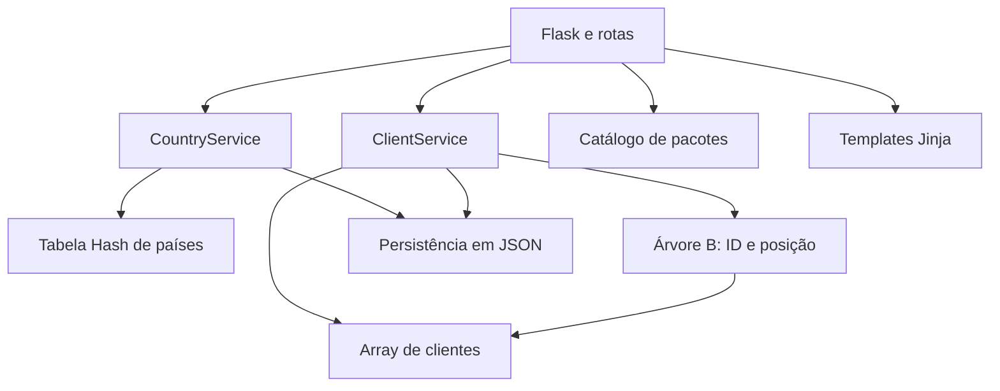
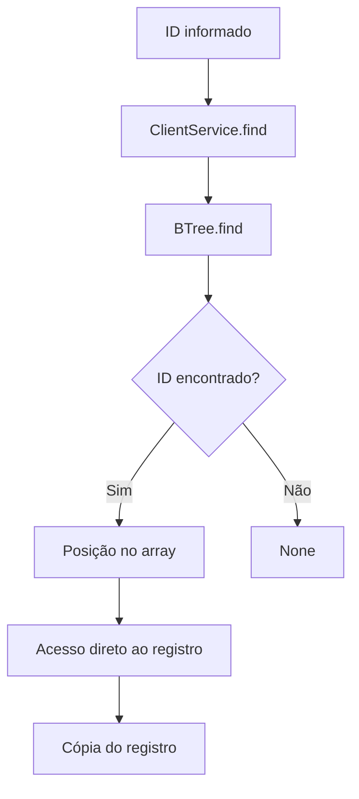

# GlobalSIM — Entrega da Etapa 2

| Identificação | Informação |
|---|---|
| Disciplina | Estruturas de Dados II |
| Curso e instituição | Sistemas de Informação, Universidade do Estado da Bahia (UNEB) |
| Equipe | Anderson de Jesus Soledade Filho, João Cleber Freire Ramos Pinto e Sofia Macêdo Costa |
| Etapa e prazo | Etapa 2 — Árvore B e gerenciamento de clientes, 24/11/2026 |

A Etapa 2 amplia o GlobalSIM para gerenciar clientes, eSIMs e pacotes com uma Árvore B. O cadastro de países e as consultas de cobertura da Etapa 1 continuam disponíveis na Tabela Hash. A consulta cliente × destino e o Planejador Multidestinos integram as duas estruturas.

A referência do checklist é o enunciado `TrabalhoPratico-2026.2.pdf`. As páginas 4–6 especificam a Etapa 2. As páginas 2 e 9 definem as regras gerais e a persistência. A página 10 lista os critérios de avaliação e as responsabilidades na apresentação.

## Correção posterior à entrega

Após a apresentação da Etapa 2, a implementação foi revisada para utilizar a Árvore B como índice dos registros de clientes, conforme a orientação recebida da professora.

A árvore passou a armazenar os IDs e as posições dos registros em um array mantido pelo `ClientService`, separando a responsabilidade de indexação da responsabilidade de armazenamento.

A correção foi desenvolvida na branch `fix/b-tree-indexing`, preservando os algoritmos de busca, inserção, divisão, balanceamento e percurso em ordem.

A interface pública do serviço de clientes permaneceu inalterada, mantendo a integração com Flask, Tabela Hash, catálogo de pacotes e Planejador Multidestinos.

## Execução e testes

Use Python 3.10 ou superior. Na raiz do repositório, instale as dependências e inicie a aplicação.

```bash
python3 -m venv .venv
source .venv/bin/activate
python -m pip install -r requirements.txt
python -m flask --app globalsim.app:create_app run
```

Acesse [http://127.0.0.1:5000](http://127.0.0.1:5000).

Para preparar uma apresentação utilizando dados isolados, siga o [roteiro de demonstração](#roteiro-de-demonstração).

Execute a suíte na raiz, com o ambiente virtual ativo:

```bash
python -m unittest discover -s tests -v
python -m unittest discover -s tests -q
```

Na revisão `7951f69` da branch `dev`, após a integração dos PRs #18 e #19, a suíte completa passou com **225 testes automatizados**.

Após a correção da Árvore B como índice de posições, em 27/11/2026, a suíte completa passou com **240 testes automatizados**, sem falhas ou erros, utilizando Python 3.10.12.

Os testes abrangem a Tabela Hash, a Árvore B, os serviços, a persistência em JSON, as rotas Flask, o Planejador Multidestinos e a geração da base demonstrativa.

Os testes específicos da correção verificam a correspondência entre IDs e posições, o acesso direto aos registros, a preservação das associações durante divisões, a estabilidade das posições, a reconstrução do índice e o rollback.

Durante a validação original, a aplicação também foi verificada manualmente pelo navegador. O Planejador recebeu uma viagem com origem BR, destinos PT, FR e IT, duração de 25 dias e consumo de 8 GB, recomendando corretamente o pacote Europa Plus (102), com 10 GB e validade de 30 dias.

Após a correção, foram verificadas manualmente as páginas inicial, de clientes e de países, além do fluxo de busca, edição e consulta integrada de cobertura.

## Arquitetura e estruturas

[`create_app()`](../globalsim/app.py) inicializa os serviços com os arquivos de dados e registra os Blueprints de países, clientes e planejamento.

As [rotas](../globalsim/routes/) processam parâmetros e formulários, chamam os serviços e renderizam [templates Jinja](../globalsim/templates/).

Os [modelos](../globalsim/models/) validam e normalizam os registros.

Os [serviços](../globalsim/services/) coordenam as operações sobre as [estruturas em memória](../globalsim/structures/) e os módulos de [persistência](../globalsim/persistence/).

Os [testes](../tests/) exercitam estruturas, serviços, persistência e fluxos Flask com arquivos temporários.



### Tabela Hash

[`HashTable`](../globalsim/structures/hash_table.py) encapsula um `dict` do Python que guarda cada país pelo código de duas letras, como `IT`.

O [serviço de países](../globalsim/services/countries.py) normaliza o código, e a busca usa `dict.get()` sobre os dados carregados.

A estrutura permite inserir, consultar, atualizar, remover e listar registros. O código permanece imutável na edição.

A página `/instrumentation` mostra chaves, tamanho, registros carregados, buscas, acertos, buscas sem resultado e contadores de inserção, alteração e remoção.

O `dict` trata colisões internamente. A aplicação mede operações da Hash.

### Árvore B

[`BTree`](../globalsim/structures/b_tree.py) é uma árvore balanceada com várias chaves por nó e folhas no mesmo nível. Esse agrupamento reduz a quantidade de níveis que uma busca precisa percorrer.

Cada chave representa o ID inteiro, positivo, único e imutável de um cliente.

A informação associada à chave é a posição do registro no array mantido pelo `ClientService`.

Os nós possuem listas de chaves, posições e referências para os filhos, além de um indicador de nó folha.

O grau mínimo `t` padrão é 3, o que permite até `2t - 1` chaves por nó, ou cinco. Um nó que fica abaixo da raiz tem pelo menos `t - 1` chaves.

- **Busca.** Compara o ID com as chaves do nó em ordem. Se encontrar uma igualdade, devolve a posição correspondente. Caso contrário, desce pelo filho correspondente ao intervalo, ou retorna `None` ao chegar a uma folha sem encontrar a chave.

- **Inserção.** Recebe o ID e a posição do registro. Verifica se o ID já existe, divide a raiz cheia se necessário e, durante a descida, divide um filho cheio antes de entrar nele. A chave mediana e sua posição sobem para o pai, e as chaves e posições restantes são repartidas em dois nós. Uma divisão da raiz acrescenta um nível.

- **Listagem.** O percurso em ordem visita cada filho intercalado com as chaves do nó e devolve as posições correspondentes aos IDs em ordem crescente.

- **Métricas.** `/clients/instrumentation` mostra clientes indexados, altura em níveis, quantidade de nós, divisões e buscas. As divisões feitas na carga também contam. O total de buscas inclui acertos, buscas sem resultado e chamadas a `find()` nas atualizações. A busca Web por um ID existente redireciona à tela de detalhes, que consulta o mesmo ID novamente.

A Árvore B não armazena os registros completos nem conhece diretamente o arquivo JSON.

### Array de clientes e indexação

O [serviço de clientes](../globalsim/services/clients.py) mantém os registros completos em uma lista Python utilizada como array dinâmico.

Cada posição do array possui um registro correspondente a um ID indexado na Árvore B.

Exemplo:

| Posição no array | ID do cliente |
|---:|---:|
| 0 | 30 |
| 1 | 10 |
| 2 | 20 |

A árvore organiza as associações:

| ID | Posição |
|---:|---:|
| 10 | 1 |
| 20 | 2 |
| 30 | 0 |

Ao consultar o ID 20, a árvore retorna a posição 2. O serviço recupera diretamente o registro armazenado em `self.clients[2]`.

A posição zero é válida e não pode ser confundida com `None`, que representa a ausência de uma chave.

O cadastro utiliza a quantidade atual de registros para determinar a próxima posição. O novo registro é acrescentado ao final do array, preservando as posições dos clientes existentes.

Na listagem, o serviço recupera os registros seguindo as posições retornadas pelo percurso em ordem da árvore.

Na edição, o serviço valida os campos e substitui o registro na mesma posição do array. O ID permanece imutável, e a atualização não exige reorganização ou reinserção na árvore.

O array não é ordenado durante essas operações, pois isso alteraria as posições utilizadas pelo índice.

### Fluxo de busca por ID



A busca individual não percorre linearmente os registros do array.

### Complexidade das operações

Considerando o grau mínimo da Árvore B fixo e registros com quantidade fixa de campos:

| Operação | Complexidade |
|---|---|
| Busca na Árvore B | O(log n) |
| Inserção de uma associação na árvore | O(log n) |
| Acesso direto ao array | O(1) |
| Acréscimo ao final do array | O(1) amortizado |
| Busca completa pelo ClientService | O(log n) |
| Percurso e listagem completa | O(n) |
| Cadastro com persistência e rollback | O(n) |
| Atualização com persistência e rollback | O(n) |

O custo linear das mutações completas decorre da gravação dos registros em JSON e das cópias das estruturas utilizadas para restaurar o estado anterior em caso de falha.

### Persistência e catálogo

Na inicialização, `CountryService` e `ClientService` leem e validam os JSONs.

O serviço de países armazena os registros na Tabela Hash.

O serviço de clientes armazena os registros completos em um array e constrói o índice da Árvore B utilizando as posições correspondentes.

Um arquivo de clientes ausente inicia a árvore e o array vazios, e um JSON inválido interrompe a carga.

O [catálogo](../globalsim/services/packages.py) valida os pacotes uma vez e os mantém em um dicionário por código.

As consultas posteriores usam os serviços e os dados em memória.

Depois de uma mutação, os serviços de países e clientes gravam os registros completos em um arquivo temporário e substituem o destino atomicamente com `os.replace()`.

No serviço de clientes, o JSON é gravado preservando a ordem do array.

Se a operação falhar, o serviço de países restaura o estado anterior da Hash, enquanto o serviço de clientes restaura o estado anterior da Árvore B, do array e das métricas.

O JSON guarda os registros completos, não a organização interna da árvore. Na próxima inicialização, o array é carregado, o índice é reconstruído e os contadores são recalculados para a nova instância.

O enunciado permite armazenar os pacotes em JSON ou lista. O [catálogo simulado](../globalsim/data/packages.json) contém os cinco pacotes da tabela.

| Código | Pacote | Franquia | Validade | Países |
|---|---|---:|---:|---|
| 101 | Europa Basic | 5 GB | 15 dias | PT, ES, FR, IT |
| 102 | Europa Plus | 10 GB | 30 dias | PT, ES, FR, IT |
| 201 | América Basic | 5 GB | 15 dias | BR, US, CA |
| 202 | América Plus | 15 GB | 30 dias | BR, US, CA |
| 301 | Global | 20 GB | 30 dias | BR, PT, ES, FR, IT, US, CA, JP |

### Base demonstrativa de 1.000 clientes

A Etapa 2 inclui uma base demonstrativa versionada em [`globalsim/data/clients.demo.json`](../globalsim/data/clients.demo.json).

O arquivo contém 1.000 registros com IDs únicos de 1 a 1.000. Cada registro possui nome, e-mail, eSIM, pacote e status.

O [gerador](../scripts/generate_clients_demo.py) utiliza uma semente fixa para reproduzir o embaralhamento dos registros, permitindo construir o índice da Árvore B em uma ordem diferente da sequência crescente dos IDs.

A base apresenta:

- 1.000 IDs únicos.
- 800 clientes com eSIM.
- 200 clientes sem eSIM e sem pacote.
- Pacotes associados utilizando os códigos existentes no catálogo.
- Clientes ativos e inativos.
- Ordem de inserção embaralhada.
- E-mails demonstrativos no domínio `example.test`.

O carregamento é realizado pelo `ClientService`, que armazena os registros no array e indexa suas posições na Árvore B.

A [documentação específica](client_seed.md) apresenta o processo de geração, as proteções contra sobrescrita e os testes.

### Consulta cliente × país

Em [`/clients/coverage`](../globalsim/routes/clients.py), o ID é consultado na Árvore B para recuperar a posição do cliente no array, e o código localiza o país na Tabela Hash.

O serviço de pacotes consulta o código associado ao cliente.

A tela mostra os dados das duas consultas e compara o destino com a lista de países do pacote.

A cobertura cadastrada depende da Hash. A compatibilidade é geográfica e independe do status do cliente.

### Planejador Multidestinos

O [Planejador Multidestinos com Recomendação Automática de Pacotes eSIM](differential.md) recebe a origem, os destinos em ordem, a duração, o consumo estimado e um ID de cliente opcional.

A origem é validada pelo formato. A Hash verifica a cobertura dos destinos, com códigos repetidos reduzidos à primeira ocorrência.

O [serviço](../globalsim/services/trip_planner.py) seleciona pacotes que abrangem todos os destinos e atendem à franquia e à validade.

Entre os elegíveis, prioriza a menor franquia suficiente, a menor validade excedente e, por último, o menor código.

A tela exibe a cobertura de cada destino, o pacote recomendado, quando houver, e a justificativa da seleção ou da ausência de opção.

O `ClientService` utiliza a Árvore B para localizar a posição do cliente informado e recupera o registro no array para mostrar o eSIM e o pacote atual.

A recomendação é consultiva e usa um único pacote simulado. A verificação de conectividade e de rotas por trecho fica para a Etapa 3.

## Checklist de requisitos e critérios de avaliação

| Enunciado | Implementação | Como verificar | Situação |
|---|---|---|---|
| Preservar a Etapa 1 e a Hash (p. 1, 3–6, 10) | [Hash](../globalsim/structures/hash_table.py), [rotas de países](../globalsim/routes/countries.py), [JSON de países](../globalsim/persistence/countries_json.py) | Demonstração 1 e [testes de rotas](../tests/test_routes.py). | Concluído e verificado |
| Árvore B funcional com ID único como chave, busca efetiva e divisões (p. 2, 4–6, 10) | [Árvore B](../globalsim/structures/b_tree.py), [modelo](../globalsim/models/client.py), [serviço](../globalsim/services/clients.py) | [Testes da Árvore B](../tests/test_b_tree.py), inclusive duplicatas, inserções e divisões. | Concluído e verificado |
| Carregar dados na Árvore B e trabalhar com centenas de clientes, recomendados cerca de 1.000 gerados automaticamente (p. 4–6, 9) | [Base de 1.000 clientes](../globalsim/data/clients.demo.json), [gerador](../scripts/generate_clients_demo.py), [ClientService](../globalsim/services/clients.py) | [Testes da base](../tests/test_client_seed.py), instrumentação e demonstração 3. | Concluído e verificado |
| Cadastro, busca, listagem e alteração (p. 5–6) | [Rotas de clientes](../globalsim/routes/clients.py), [serviço](../globalsim/services/clients.py) | Demonstração 2 e [testes das rotas](../tests/test_client_routes.py). | Concluído e verificado |
| Associação de eSIM e pacote ao cliente (p. 5) | [Formulário](../globalsim/templates/client_form.html), [validação Web](../globalsim/routes/clients.py), [catálogo](../globalsim/data/packages.json) | Edite um cliente e selecione o pacote. Confira o eSIM e o pacote nos detalhes e na consulta integrada. | Concluído e verificado |
| Persistência e consultas pelas estruturas em memória (p. 2, 5, 9) | [Persistência](../globalsim/persistence/), [serviços de países e clientes](../globalsim/services/) | Reinicie com os mesmos arquivos. Os [testes de clientes](../tests/test_client_service.py) e [de países](../tests/test_country_service.py) exercitam carga, consultas e falhas. | Concluído e verificado |
| Integração cliente × país e consulta ao catálogo (p. 5–6, 10) | [Rota integrada](../globalsim/routes/clients.py), [serviço de pacotes](../globalsim/services/packages.py) | Demonstração 4 e [testes das rotas](../tests/test_client_routes.py). | Concluído e verificado |
| Primeira versão funcional do diferencial aprovado (p. 2, 6, 10) | [Serviço](../globalsim/services/trip_planner.py), [Blueprint](../globalsim/routes/trip_planner.py), [fábrica Flask](../globalsim/app.py) | Demonstração 5 e [testes de integração](../tests/test_stage2_integration.py). | Concluído e verificado |
| Python/Flask, formulários HTML e Jinja, mutações por POST e estruturas separadas das rotas (p. 2, 10) | [Aplicação](../globalsim/app.py), [rotas](../globalsim/routes/), [templates](../globalsim/templates/), [estruturas](../globalsim/structures/) | Use os formulários e confira os redirecionamentos 303 após salvar com sucesso. | Concluído e verificado |
| Instrumentação da Hash e da Árvore B (p. 4, 10) | [Tela da Hash](../globalsim/templates/instrumentation.html), [tela da Árvore B](../globalsim/templates/client_instrumentation.html) | Compare métricas antes e depois das operações nas demonstrações 1 e 3. | Concluído e verificado |
| Repositório e README com equipe, execução, estruturas e diferencial (p. 10) | [README](../README.md), este guia | Confira a identificação e execute os comandos da raiz do repositório. | Preparado para revisão |
| Demonstração funcional e domínio de todos os integrantes (p. 10) | [Roteiro](#roteiro-de-demonstração) e [perguntas](#preparação-para-a-apresentação) | Cada integrante explica as estruturas, a ligação com Flask e a decisão do recomendador. | Roteiro pronto. Ensaio da equipe pendente |
| Grafo ponderado, BFS, DFS, Dijkstra, visualização e integração com a rede (p. 6–8, 10) | Escopo da entrega de 01/12/2026 | Demonstrar conectividade e rota de menor latência na entrega final. | Reservado para a Etapa 3 |

### Checklist da correção posterior à entrega

| Orientação | Implementação | Situação |
|---|---|---|
| Utilizar a Árvore B como índice | Associação entre ID e posição | Concluído e verificado |
| Armazenar os registros separadamente | Array mantido pelo ClientService | Concluído e verificado |
| Recuperar os registros por meio do índice | Busca na árvore seguida de acesso direto ao array | Concluído e verificado |
| Preservar o balanceamento | Divisões mantêm chaves e posições associadas | Concluído e verificado |
| Preservar as funcionalidades existentes | Interface pública do ClientService mantida | Concluído e verificado |
| Validar a consistência das estruturas | Testes de cadastro, busca, atualização e rollback | Concluído e verificado |
| Validar o sistema completo | 240 testes automatizados aprovados | Concluído e verificado |

## Roteiro de demonstração

### Preparação

Para evitar modificar os arquivos permanentes do projeto, utilize cópias temporárias dos dados de países e clientes.

Na raiz do repositório, execute:

```bash
demo_dir="$(mktemp -d)"
cp globalsim/data/countries.demo.json "$demo_dir/countries.json"
cp globalsim/data/clients.demo.json "$demo_dir/clients.json"
```

Esses comandos criam uma base de demonstração separada dos arquivos principais.

O arquivo de clientes já contém os 1.000 registros demonstrativos.

Inicie o Flask utilizando os arquivos temporários:

```bash
python -m flask --app "globalsim.app:create_app({'COUNTRIES_PATH': '$demo_dir/countries.json', 'CLIENTS_PATH': '$demo_dir/clients.json'})" run
```

Abra [http://127.0.0.1:5000](http://127.0.0.1:5000).

Para demonstrar a persistência após reiniciar a aplicação, encerre o servidor com `Ctrl+C` e execute novamente o mesmo comando, reutilizando o diretório temporário.

### 1. Etapa 1 preservada

Abra `/` e `/countries`.

Em `/coverage?codigo=IT`, confira Itália, Europa e 5G.

Abra `/instrumentation`, cadastre `DE` em `/countries/new` com Alemanha, Europa, Operadora DE e 5G, e consulte a cobertura do novo país.

Edite a operadora ou remova DE pelo formulário de listagem.

Volte à instrumentação para observar as operações e confirme que IT continua disponível.

### 2. Gerenciamento de clientes

Abra `/clients`.

A base demonstrativa contém inicialmente 1.000 clientes.

Em `/clients/new`, cadastre o ID **58372** com nome **Cliente Demonstração**, e-mail `cliente.demo@example.test` e status `ativo`.

Esse é um registro de ensaio criado durante a apresentação, fora do intervalo de IDs da base original.

Após o cadastro, a aplicação deverá conter 1.001 clientes.

O novo registro será armazenado na posição 1.000 do array, e a Árvore B estabelecerá a associação entre o ID 58372 e essa posição, considerando que nenhum outro cliente tenha sido cadastrado anteriormente durante o ensaio.

Busque o ID em `/clients/search?id=58372` e abra a edição para associar o eSIM `ESIM-DEMO-01` e o pacote **Europa Plus (102)**.

A atualização preserva a posição do registro e a chave existente na árvore.

Reinicie a aplicação utilizando o mesmo diretório temporário e consulte `/clients/58372` para comprovar a persistência e a reconstrução do índice.

### 3. Carga e instrumentação com grande volume

Abra `/clients/instrumentation` logo após iniciar a aplicação, antes do cadastro do cliente de ensaio, para observar a carga inicial de **1.000 clientes**.

Confira a quantidade carregada, a altura, o número de nós e as divisões.

Na base demonstrativa versionada, os resultados de referência documentados da carga são:

| Métrica | Resultado inicial esperado |
|---|---:|
| Clientes | 1.000 |
| Altura | 5 |
| Nós | 315 |
| Divisões | 310 |
| Buscas | 0 |

Os valores podem mudar após inserções ou consultas realizadas durante a demonstração.

Em `/clients`, mostre que os registros aparecem em ordem crescente de ID, mesmo que a ordem de inserção original tenha sido embaralhada.

Explique que o array preserva a ordem de carregamento, enquanto o percurso da Árvore B fornece as posições em ordem crescente das chaves.

Busque um cliente existente, como o ID `1`.

Depois, busque um ID ausente, como `1001`, antes de cadastrar novos registros com esse identificador.

Volte à instrumentação para comparar o total de buscas.

A altura representa a quantidade de níveis da árvore. A contagem de nós representa as unidades estruturais, enquanto as divisões registram os desdobramentos realizados durante a inserção.

Se o cliente de ensaio `58372` já tiver sido cadastrado, a quantidade total será de 1.001 clientes.

A geração e a validação da base são explicadas em [Base demonstrativa de clientes](client_seed.md).

### Demonstração complementar da indexação

Para demonstrar diretamente a separação entre armazenamento e indexação, execute na raiz do repositório, com o ambiente virtual ativo:

```bash
python - <<'PY'
from globalsim.services.clients import ClientService

service = ClientService(
    "globalsim/data/clients.demo.json"
)

client_id = 500

position = service.tree.find(client_id)

assert position is not None

record = service.clients[position]

assert record["id"] == client_id

print("ID:", client_id)
print("Posição no array:", position)
print("Registro completo:", record)

print(
    "Quantidade de registros:",
    len(service.clients)
)

print(
    "Quantidade de chaves indexadas:",
    service.statistics()["size"]
)
PY
```

Essa demonstração não modifica o arquivo original.

O objetivo é mostrar que a Árvore B retorna uma posição, enquanto o registro completo é recuperado diretamente do array.

### 4. Consulta integrada

Abra `/clients/coverage?client_id=58372&codigo=IT` após criar o cliente da demonstração 2.

Confira a identificação, o eSIM e o pacote Europa Plus.

Mostre Itália, a operadora, a tecnologia 5G e a compatibilidade geográfica.

Em seguida, troque IT por JP para mostrar um país com cobertura cadastrada e fora do pacote Europa Plus.

A Árvore B localiza a posição do cliente, o serviço recupera o registro no array, a Hash localiza o país e a rota verifica a compatibilidade com os dados do catálogo.

### 5. Planejador

Abra `/trip-planner` pelo menu e informe:

- Origem: `BR`.
- Destinos: `PT, FR, IT`.
- Duração: `25` dias.
- Consumo estimado: `8` GB.

A tela deve mostrar cobertura nos três destinos e recomendar **Europa Plus (102)**, com **10 GB** e **30 dias** de validade.

O Europa Basic é insuficiente em franquia e validade.

O pacote Global também é elegível, mas possui franquia maior.

| Variação | Resultado para conferir |
|---|---|
| Acrescente `ZZ` aos destinos, mantendo o restante | A tela indica o destino sem cobertura cadastrada e encerra a seleção. |
| Mantenha o roteiro e use 21 GB | Os destinos têm cobertura. Nenhum pacote do catálogo tem franquia suficiente. |
| Informe o cliente `58372` da demonstração 2 | A tela mostra o eSIM e Europa Plus como pacote atual para comparação. |
| Informe um ID inexistente, como `99999` | O cliente aparece como inexistente e a recomendação para a viagem continua disponível. |

Mostre o caso principal e escolha uma variação.

Para evidenciar a integração com a Árvore B, utilize o cliente cadastrado durante a demonstração.